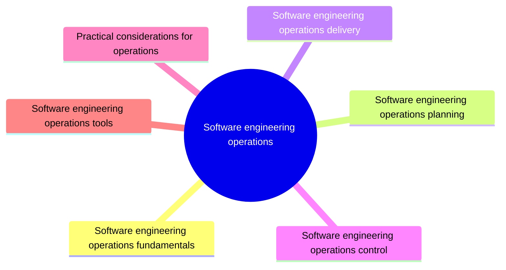

# Software engineering operations

Software engineering operations covers the activities that deploy, run, monitor and support software in production. This knowledge area covers operations fundamentals, planning, delivery, control through monitoring and service levels, and operations tools.

This knowledge area follows Chapter 6 of the [SWEBOK Guide V4.0](https://www.computer.org/education/bodies-of-knowledge/software-engineering) (IEEE Computer Society, 2024). Its sections are the topics of that chapter, in the same order.

## Map

The map shows the sections of this part of the library.

## Topics

- [Software engineering operations fundamentals](fundamentals/README.md) (planned): What operations means for a software engineer, and how DevOps and site reliability engineering connect development with operations.
- [Software engineering operations planning](planning/README.md) (planned): Planning the operational side of a system: capacity, availability, backup and recovery, and the operations environment.
- [Software engineering operations delivery](delivery/README.md) (planned): Getting changes into production safely: build and deployment pipelines and deployment strategies.
- [Software engineering operations control](control/README.md) (11 notes): Keeping a running system under control: monitoring, service level management, operational metrics and incident handling.
- [Practical considerations for operations](practical-considerations/README.md) (planned): Practical concerns of running software: incident response, on call work and operating in the cloud.
- [Software engineering operations tools](tools/README.md) (planned): Tools for deployment automation, monitoring, logging and incident management.

## Related elsewhere in the library

- [Twelve-factor app](../software-construction/practical-considerations/twelve-factor-app.md): Construction rules that make an application easy to deploy and operate.
- [High availability patterns](../software-architecture/cloud-design-patterns/high-availability/README.md): Patterns that keep a running system available.
