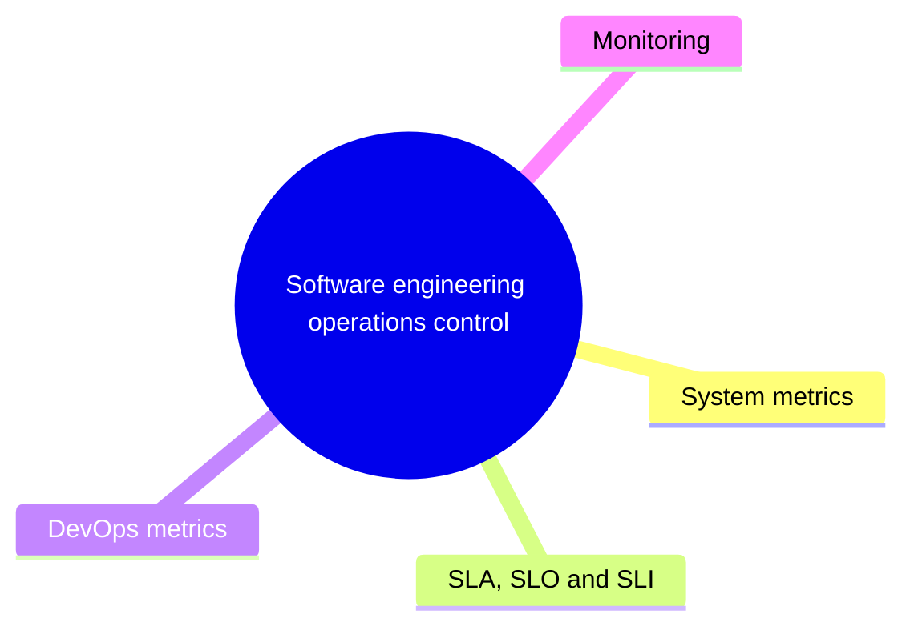

# Software engineering operations control

Keeping a running system under control: monitoring, service level management, operational metrics and incident handling.

This section corresponds to topic 6.4 of the [SWEBOK Guide V4.0](https://www.computer.org/education/bodies-of-knowledge/software-engineering).

## Map

The map shows the notes and sections of this part of the library.

## Reading order

1. [System metrics](system-metrics.md): In system design, metrics are essential for assessing and maintaining the performance, reliability, and overall quality of a system.
2. [SLA, SLO and SLI](sla-slo-sli.md): An SLA is a formal, contractual agreement between a service provider and a customer that defines the expected standards of service.
3. [DevOps metrics](devops-metrics.md): DevOps metrics measure how fast and how safely a team delivers software: deployment size, deployment frequency, deployment time, lead time and availability.

## Sections

- [Monitoring](monitoring/README.md) (8 notes): Collecting and analyzing telemetry about health, availability, performance, security, service levels and usage of a running system.

## Planned topics

- Incident management
- Blameless postmortems
- Error budgets
- Alerting strategy
