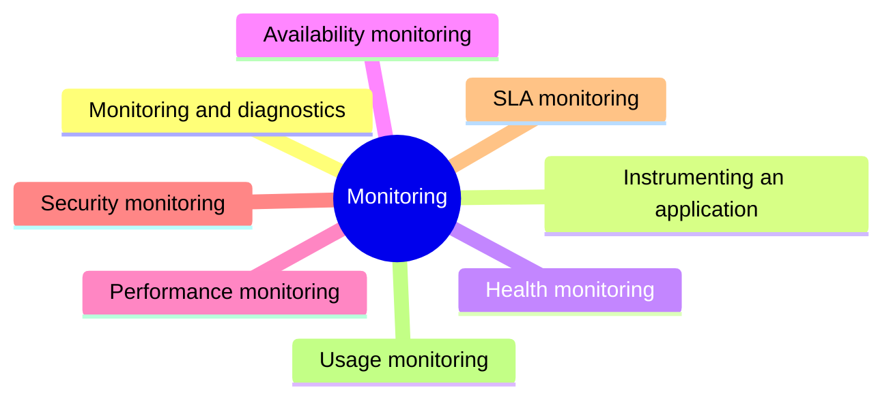

# Monitoring

Collecting and analyzing telemetry about health, availability, performance, security, service levels and usage of a running system.

This section corresponds to topic 6.4 of the [SWEBOK Guide V4.0](https://www.computer.org/education/bodies-of-knowledge/software-engineering).

## Map

The map shows the notes and sections of this part of the library.

## Reading order

1. [Monitoring and diagnostics](monitoring-and-diagnostics.md): Monitoring and diagnostics is the continuous collection and analysis of telemetry from a running system, to know whether it is healthy, available, fast, secure and used as expected.
2. [Instrumenting an application](instrumenting-an-application.md): Instrumentation is the process of adding code to an application to monitor its performance, health, and other aspects by capturing data.
3. [Health monitoring](health-monitoring.md): A system is healthy if it is running and capable of processing requests.
4. [Availability monitoring](availability-monitoring.md): A healthy system needs all parts to be available, with availability monitoring tracking uptime statistics, distinct from health monitoring's real-time status.
5. [Performance monitoring](performance-monitoring.md): Performance monitoring measures how quickly and efficiently a system handles its workload, using indicators such as response time, request rate, error rate and resource utilization.
6. [Security monitoring](security-monitoring.md): Security monitoring collects and analyzes events that may indicate an attack or misuse: failed sign-ins, unusual access patterns, changes to privileges and suspicious requests.
7. [SLA monitoring](sla-monitoring.md): SLA monitoring checks whether a system meets the service level agreements it promises to customers, such as availability and response time targets.
8. [Usage monitoring](usage-monitoring.md): Usage monitoring tracks how the features and components of an application are used.

## Planned topics

- Observability: logs, metrics and traces
- OpenTelemetry
- Distributed tracing
