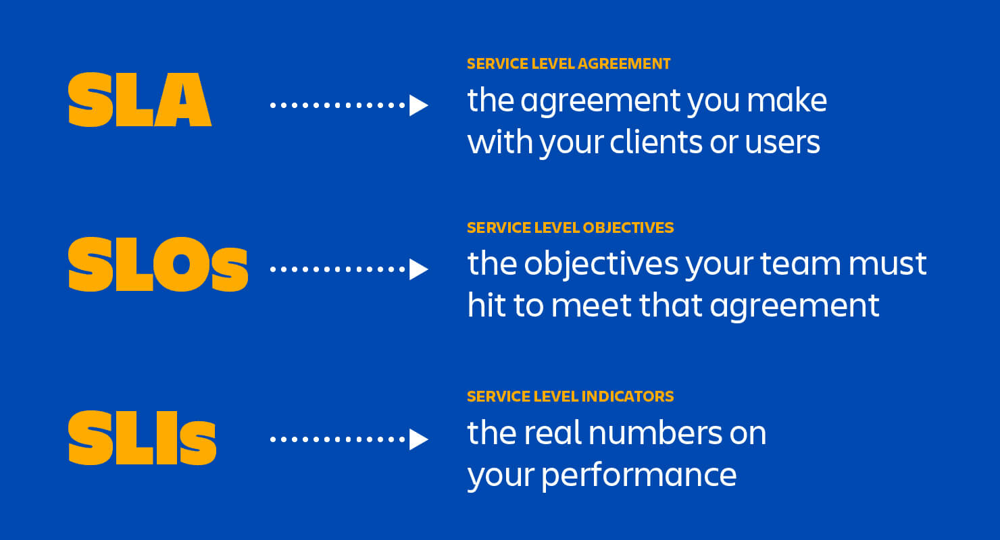
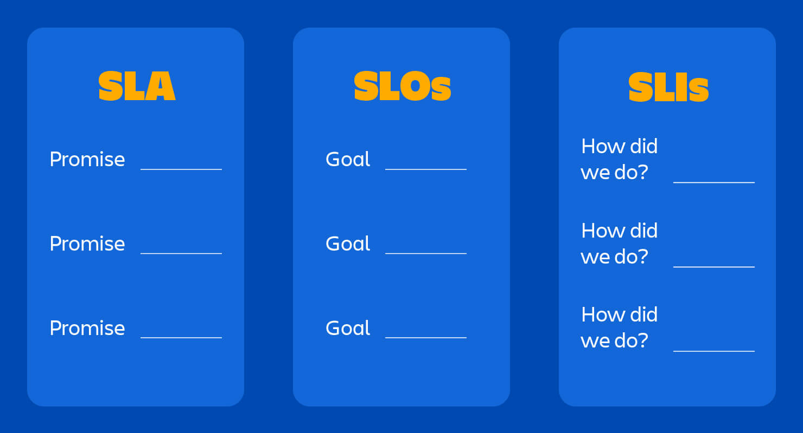

# SLA, SLO and SLI

## Summary

An SLA is a formal, contractual agreement between a service provider and a customer that defines the expected standards of service. It specifies the level of service the provider commits to delivering, typically detailing key metrics like uptime, response times, and resolution times for issues.

## Prerequisites

TODO: link the notes a reader should know first.

## Core concepts

### SLA (service level agreement)

An SLA is a formal, contractual agreement between a service provider and a customer that defines the expected standards of service. It specifies the level of service the provider commits to delivering, typically detailing key metrics like uptime, response times, and resolution times for issues.

#### Usage

SLAs act as a commitment to the customer, ensuring a predictable level of service quality. They are used as a baseline for accountability, often including penalties for failing to meet agreed-upon targets, like refunds or service credits.

#### Role

SLAs establish trust by setting clear, mutual expectations between the service provider and the customer. They help the provider manage customer expectations while allowing the customer to hold the provider accountable.

#### Measurement

SLAs are measured through performance monitoring tools that track uptime, response times, and other critical metrics over time. For example, a common SLA metric might be "99.9% uptime monthly," meaning the system should be operational 99.9% of the time within any given month.

#### Business context

SLAs are critical in business-to-business (B2B) environments where service reliability is crucial for client operations. For example, a SaaS provider guarantees 99.9% uptime to a financial services firm. This SLA allows the firm to confidently rely on the service, knowing that downtime is minimized and managed according to agreed terms.

### SLO (service level objective)

An SLO is a specific, measurable target within the broader SLA, defining what level of service performance should be achieved. SLOs typically specify targets for metrics such as availability, response times, or error rates.

#### Usage

SLOs break down SLAs into manageable objectives for internal teams. While the SLA is often negotiated with the customer, SLOs are typically set by the service provider based on realistic operational capabilities and are used to guide the performance of various teams.

#### Role

SLOs serve as the actionable benchmarks within an SLA. They help engineering and operations teams focus on specific targets to maintain service quality and ensure SLA commitments are met.

#### Measurement

SLOs are typically tracked over specific periods and measured as percentages. For instance, an SLO for response time might aim to ensure that "90% of requests are responded to within 1 second." This metric is tracked through system logs and monitoring tools.

#### Business context

SLOs are essential for managing internal operations. For example, a cloud provider may set an SLO of 95% success rate for API responses within 500 ms to maintain the overall SLA of high availability and low latency. This allows the provider to allocate resources and manage team responsibilities to meet the expected service levels.

### SLI (service level indicator)

An SLI is a quantifiable measure of service performance that shows how well the system is performing in relation to its SLOs. SLIs are data points gathered from monitoring the system and provide the foundation for evaluating whether SLOs are being met.

#### Usage

SLIs track real-time performance and provide feedback on whether the service is operating within acceptable levels. They are used by engineers and monitoring teams to ensure the system’s health and provide early indicators of potential issues.

#### Role

SLIs are the operational metrics that offer visibility into the health of the service. They provide actionable insights that inform the provider if they are on track to meet SLOs and, by extension, SLAs.

#### Measurement

SLIs are measured through metrics like error rate, latency, and request success rate. For example, if the SLO states that "95% of requests should have under 200 ms latency," the SLI would be the actual percentage of requests processed within 200 ms, calculated through system logs and monitoring dashboards.

#### Business context

SLIs are essential for tracking real-time system health and anticipating potential SLA violations. For instance, an e-commerce platform may use SLIs to monitor transaction success rates. If the SLI shows a significant drop, it alerts the team to investigate and fix issues, helping avoid breaching the SLA and maintaining customer satisfaction.

### Business impact

In business, these metrics collectively help maintain service reliability, customer satisfaction, and contractual compliance. Here’s how they interrelate and support business goals:

- **SLAs** create the external promise to customers, **SLOs** are internal goals that help teams work towards fulfilling that promise, and **SLIs** are the live indicators that show whether the goals are being achieved.
- In highly competitive markets like SaaS or cloud services, consistently meeting SLAs through strong SLOs and effective SLI tracking can be a differentiator, improving customer loyalty.
- Failure to meet SLAs can lead to penalties, financial losses, and damaged reputations, making these metrics vital for risk management and customer trust.

Each of these metrics supports continuous improvement and service optimization, driving overall operational efficiency and helping the business deliver on its promises consistently.

### Best practices

**Build SLAs Based on Customer Expectations**

Every part of a client agreement should focus on what matters to the customer. On the provider’s side, an incident might involve addressing 10 different components, but from the customer's view, the key concern is whether the system meets their expectations. SLAs and SLOs should reflect these realities by keeping commitments broad and focused on user-facing functions. This clarity makes customers happier and eases the work of IT teams responsible for meeting SLAs.

**Use Simple Language in SLAs**

Clients may hesitate to ask for clarification, so if your SLA is written in complex terms, misunderstandings could arise. The simpler the language, the lower the chance of future conflicts with the client.

**Keep SLOs Minimal and Focused**

Not every metric is crucial to customer success, meaning not all should become SLOs. Limit SLOs to the most important areas for the customer.

**Not Every Trackable Metric Should Be an SLI**

Monitoring 10 components for each of 10 SLOs can quickly become overwhelming. Instead, strategically choose indicators that are meaningful to core SLOs, and focus energy on tracking these effectively.

**Account for Factors Outside the IT Team’s Control**

What happens if the client delays issue resolution? If such situations aren’t anticipated in the SLA, your team may struggle to meet resolution standards that depend on client cooperation.

**Plan for an Error Budget**

Allowing room for errors protects the business from SLA breaches and enables agile response, giving the team flexibility to innovate and experiment. For instance, Google recommends using remaining error budget for planned downtime, which can help identify unforeseen issues while still meeting client expectations.

**Avoid Setting Unrealistic Standards**

Just because your team can achieve 99.99% uptime doesn’t mean it should be the SLO. It’s often better to under-promise and over-deliver. This approach is especially useful for agile teams aiming for frequent releases, as they need an error budget to sustain that pace.

## Worked example

TODO: add a concrete, reproducible example with real values.

## Trade offs and when to use it

TODO: describe benefits, costs, alternatives and when this is the wrong choice.

## Common mistakes

TODO: list frequent misunderstandings and failure modes, with the fix for each.

## Practice

TODO: add three to five questions, with answers at the bottom.

## Further reading

- Beyer, B., Jones, C., Petoff, J., Murphy, N. R. (eds.) (2016). [*Site Reliability Engineering, chapter 4: Service Level Objectives*](https://sre.google/sre-book/service-level-objectives/). O'Reilly Media. Defines SLIs, SLOs and SLAs and explains how to choose and use them.

TODO: check the content of this note against the sources above and record what was verified and when.
