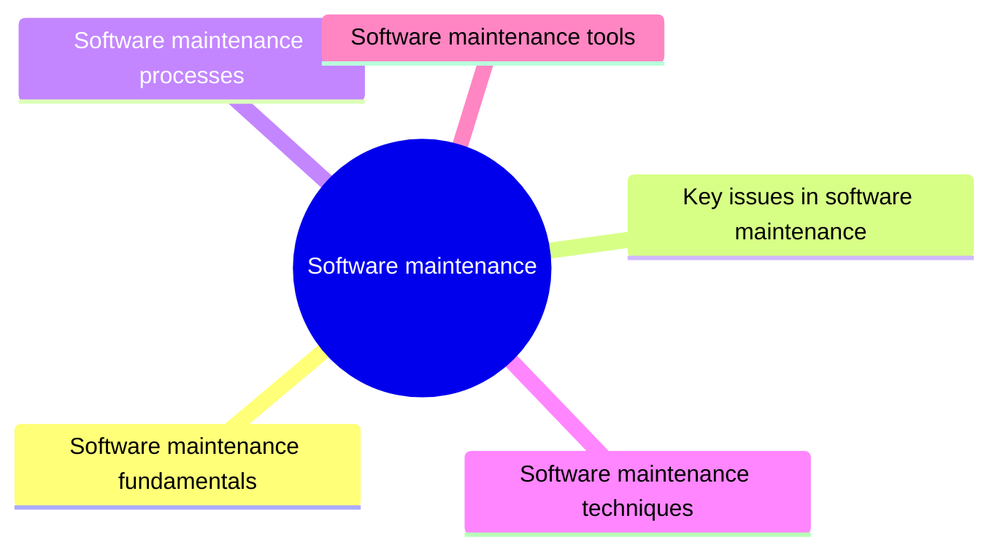

# Software maintenance

Software maintenance is the modification of a software product after delivery to correct faults, improve it or adapt it to a changed environment. This knowledge area covers its fundamentals, key issues, processes, techniques and tools.

This knowledge area follows Chapter 7 of the [SWEBOK Guide V4.0](https://www.computer.org/education/bodies-of-knowledge/software-engineering) (IEEE Computer Society, 2024). Its sections are the topics of that chapter, in the same order.

## Map

The map shows the sections of this part of the library.

## Topics

- [Software maintenance fundamentals](fundamentals/README.md) (planned): Definitions, the nature of maintenance, why it is needed and the categories of maintenance.
- [Key issues in software maintenance](key-issues/README.md) (planned): Technical and management issues of maintenance, cost estimation and measurement.
- [Software maintenance processes](processes/README.md) (planned): Maintenance processes and activities, from problem reports to modification and release.
- [Software maintenance techniques](techniques/README.md) (planned): Techniques for understanding and changing existing software: program comprehension, reengineering, reverse engineering, migration and retirement.
- [Software maintenance tools](tools/README.md) (planned): Tools for comprehension, analysis and transformation of existing code.

TODO: no notes yet. Start with the planned topics of the sections listed above.
