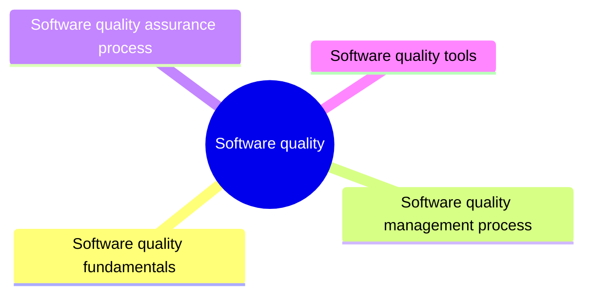

# Software quality

Software quality is the degree to which a software product meets its stated requirements and the needs of its users. This knowledge area covers quality fundamentals and quality characteristics, quality management, quality assurance and tools.

This knowledge area follows Chapter 12 of the [SWEBOK Guide V4.0](https://www.computer.org/education/bodies-of-knowledge/software-engineering) (IEEE Computer Society, 2024). Its sections are the topics of that chapter, in the same order.

## Map

The map shows the sections of this part of the library.

## Topics

- [Software quality fundamentals](fundamentals/README.md) (6 notes): Culture and ethics of quality, the value and cost of quality, quality models and characteristics.
- [Software quality management process](management-process/README.md) (planned): Planning, assurance, control and improvement of quality across the life cycle.
- [Software quality assurance process](assurance-process/README.md) (planned): Reviews, audits and verification and validation activities that give confidence in quality.
- [Software quality tools](tools/README.md) (planned): Tools that support static and dynamic quality analysis.

## Related elsewhere in the library

- [Performance antipatterns](../software-architecture/system-design/performance-antipatterns/README.md): Performance antipatterns that degrade the quality attributes described here.
- [Monitoring](../software-engineering-operations/control/monitoring/README.md): Monitoring that measures the quality attributes in production.
