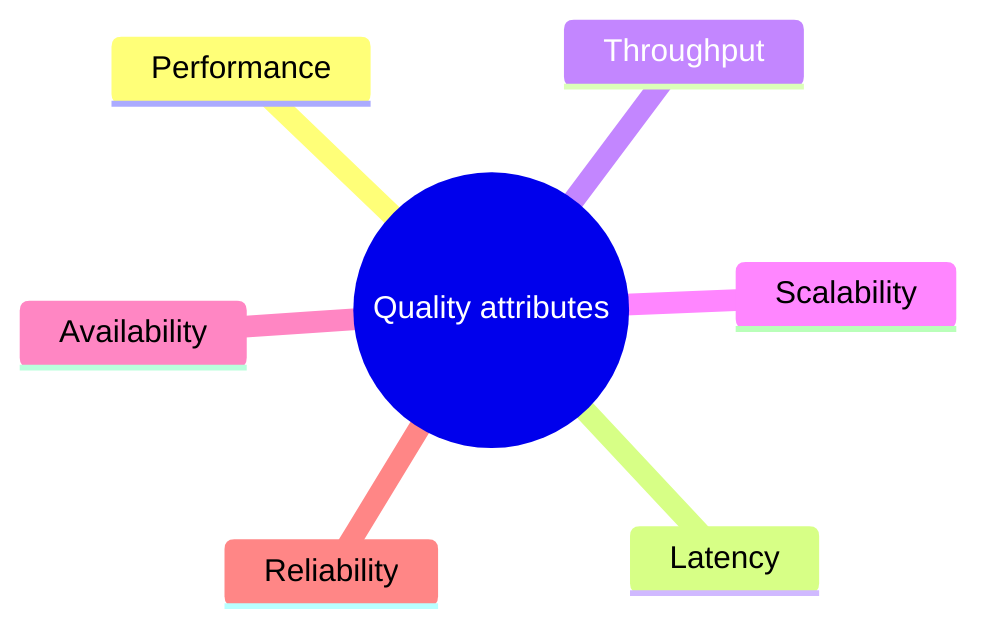

# Quality attributes

Measurable properties of a running system, such as performance, scalability, availability, latency, throughput and reliability, that architecture and design must achieve.

This section corresponds to topic 12.1 of the [SWEBOK Guide V4.0](https://www.computer.org/education/bodies-of-knowledge/software-engineering).

## Map

The map shows the notes and sections of this part of the library.

## Reading order

1. [Performance](performance.md): Performance refers to how well a system can handle a given workload or set of tasks.
2. [Latency](latency.md): Latency refers to the amount of time it takes for a system to respond to a request.
3. [Throughput](throughput.md): Throughput is the amount of work a system completes per unit of time, for example requests per second or transactions per second.
4. [Scalability](scalability.md): A service is said to be scalable if when we increase the resources in a system, it results in increased performance in a manner proportional to resources added.
5. [Availability](availability.md): Availability is the proportion of time a system is working and able to serve requests, usually expressed as a percentage of uptime such as 99.9 percent.
6. [Reliability](reliability.md): Reliability is the ability of a system to perform its required functions correctly under stated conditions for a stated period of time.

## Planned topics

- Maintainability
- Observability as a quality attribute
- Elasticity
- Durability
