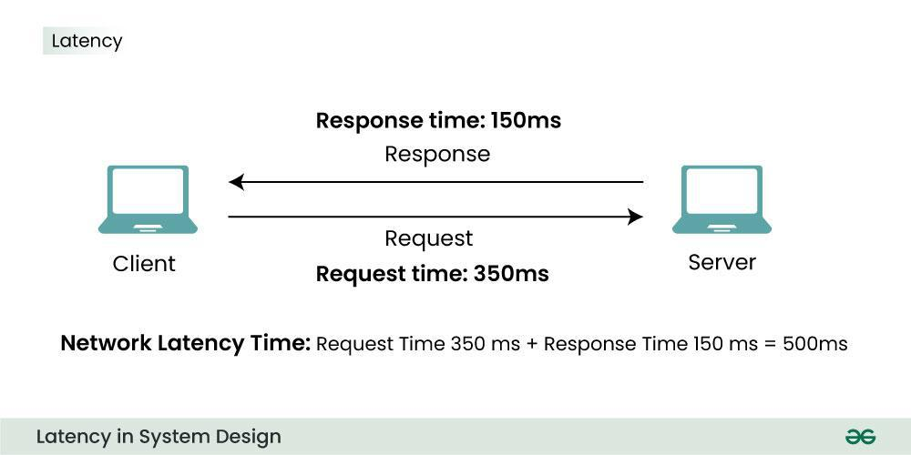
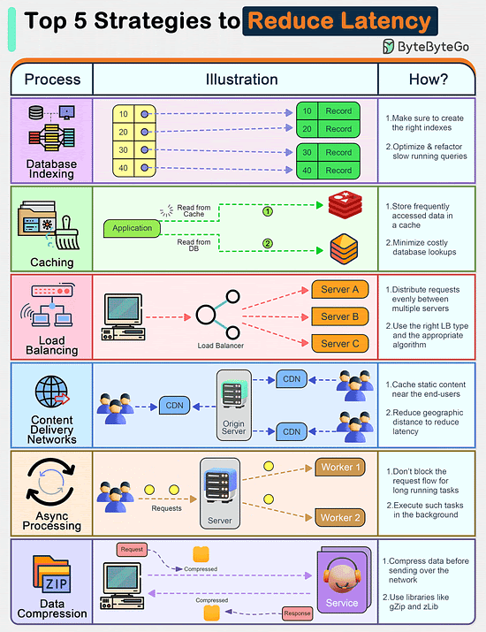
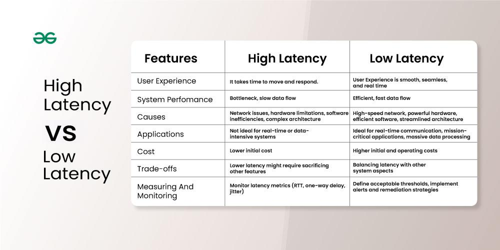

# Latency

## Summary

Latency refers to the amount of time it takes for a system to respond to a request. It is often measured in milliseconds or microseconds. Latency is a measure of how long it takes for a system to complete a task or process data. It is often measured in milliseconds or microseconds and is an important metric for determining the performance of a system.

## Prerequisites

TODO: link the notes a reader should know first.

## Core concepts

### Definition

Latency refers to the amount of time it takes for a system to respond to a request. It is often measured in milliseconds or microseconds.

- Latency represents the delay between an action and its corresponding reaction
- It can be measured in various units like seconds, milliseconds, and nanoseconds depending on the system and application.

Latency is a measure of how long it takes for a system to complete a task or process data. It is often measured in milliseconds or microseconds and is an important metric for determining the performance of a system. High latency can lead to slow performance, while low latency can result in faster and more responsive systems.

Latency can be caused by various factors e.g., network i.e. time it takes for data to travel through the network (more hops, high latency), network congestion, inefficient algorithms, load on the resources and so on.

Latency involves so many things such as processing time, time to travel over the network between components, and queuing time.

- **Round Trip Time**: This includes the time taken for the request to travel to the server, processing time at the server, and the response time back to the sender.
- **Different Components:** Processing time, transmission time (over network or between components), queueing time (waiting in line for processing), and even human reaction time can all contribue to overall latency.

### Reduce latency

## Worked example

TODO: add a concrete, reproducible example with real values.

## Trade offs and when to use it

### High latency vs low latency

#### High latency

In system design, high latency refers to a significant delay in the time it takes for data to travel from one point in the system to another and back. This delay can impact the performance and user experience of the system negatively.

Reducing high latency often involves trade-offs. Improving performance may require increased resource consumption, more complex system design, or higher costs. Striking the right balance between performance and feasibility is crucial.

##### Impact

- **Slow User Experience:**
    - High latency leads to noticeable delays in user interactions, making the system feel sluggish and unresponsive.
    - This can be frustrating for users and negatively impact their satisfaction with the system.
- **Reduced Responsiveness:**
    - In real-time applications, such as online gaming or financial trading, high latency can lead to inaccurate or delayed responses, which can have significant consequences.
- **Decreased Efficiency:**
    - Delays in data processing and communication can bottleneck the system and limit its ability to handle large loads or complex tasks efficiently.

##### Cases

- **Network Congestion:** When many devices attempt to share a network, data packets can become congested, leading to increased travel times.
- **Overloaded Servers:** When servers are overloaded with requests, they take longer to process data, causing delays.
- **Inefficient Architecture:** Choosing inappropriate hardware, software, or network protocols can lead to bottlenecks and slow data transfer.
- **Software Issues:** Bugs or inefficiencies in system software can introduce unnecessary delays in data processing or communication.
- **Physical Distance:** In geographically distributed systems, the physical distance between components can contribute to network latency.

#### Low latency

In system design, low latency refers to the minimal time it takes for data to travel from one point in the system to another and back, resulting in a swift and responsive experience. The lower the latency, the faster the system reacts to user inputs or external events.

##### Impact

- **Enhanced User Experience:**
    - Low latency translates to a smooth and seamless experience for users.
    - Think faster page loads, instant video playback, and lag-free online gaming.
    - This contributes to user satisfaction and engagement.
- **Real-time Performance:**
    - For applications like financial trading, remote control, and virtual reality, low latency is crucial.
    - It allows for near-instantaneous responses and accurate real-time decisions, ensuring smooth operation and accurate results.
- **Increased Efficiency:**
    - Minimizing delays in data processing and communication leads to a more efficient system.
    - This translates to higher throughput, better scalability, and improved overall performance.

##### Cases

- **Optimize Architecture:**
    - Choose efficient hardware, software, and network protocols that minimize processing overhead and data transfer delays.
    - This involves selecting high-performance CPUs, low-latency network cards, and efficient communication protocols.
- **Reduce Bottlenecks:**
    - Identify and eliminate points of congestion, such as overloaded servers or inefficient code segments, that slow down data flow.
    - This might involve scaling up server capacity, optimizing algorithms, or utilizing caching mechanisms.
- **Caching:**
    - Strategically cache frequently accessed data closer to users or processing points to reduce retrieval times.
    - This significantly speeds up data access and minimizes reliance on slower backend systems.

## Common mistakes

TODO: list frequent misunderstandings and failure modes, with the fix for each.

## Practice

TODO: add three to five questions, with answers at the bottom.

## Further reading

- ISO/IEC (2023). [*ISO/IEC 25010:2023 Systems and software Quality Requirements and Evaluation (SQuaRE): Product quality model*](https://www.iso.org/standard/78176.html). ISO. The product quality model whose characteristics include performance efficiency, reliability and maintainability.
- Gregg, B. (2020). *Systems Performance: Enterprise and the Cloud, 2nd Edition*. Addison-Wesley. A methodology for analyzing latency, throughput, utilization and saturation from the hardware up.

TODO: check the content of this note against the sources above and record what was verified and when.
