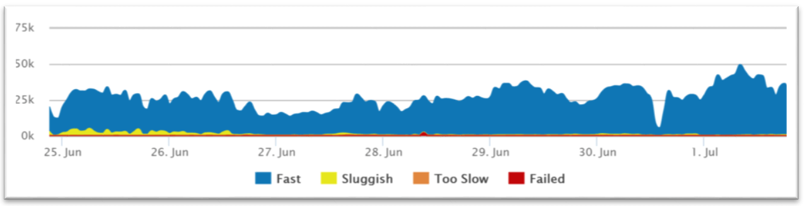

# Performance

## Summary

Performance refers to how well a system can handle a given workload or set of tasks. Performance metrics include response time, throughput, and resource usage. A high-performance system can respond quickly to user requests, process large amounts of data, and use resources efficiently.

## Prerequisites

TODO: link the notes a reader should know first.

## Core concepts

### Definition

Performance refers to how well a system can handle a given workload or set of tasks. Performance metrics include response time, throughput, and resource usage. A high-performance system can respond quickly to user requests, process large amounts of data, and use resources efficiently.

A service is **scalable** if it results in increased **performance** in a manner proportional to resources added. Generally, increasing performance means serving more units of work, but it can also be to handle larger units of work, such as when datasets grow.

Another way to look at performance vs scalability:

- If you have a **performance** problem, your system is slow for a single user.
- If you have a **scalability** problem, your system is fast for a single user but slow under heavy load.

#### Defining and measuring

Application state determines the way in which requests are processed. The current load, the complexity of the request, and other application and system factors (like CPU or network usage) all impact application responsiveness. It is the characteristics of response that define application performance. More specifically, there are three basic measures of performance:

- Response time: This is the most widely used metric of performance and it is simply a direct measure of how long it takes to process a request.
- Throughput: A straightforward count of the number of requests that the application can process within a defined time interval. For Web applications, a count of page impressions or requests per second is often used as a measure of throughput.
- System availability: Usually expressed as a percentage of application running time minus the time the application can't be accessed by users. This is an indispensable metric, because both response time nor throughput are zero when the system is unavailable.

Performance can also be defined by resource requests and by measuring resource re-quests in relation to throughput. This becomes a key metric in the context of resource planning. For instance, you may need to know which resources are needed to achieve full application scaling, which is a matter of knowing the frequency of requests for each resource type.

### APM

#### Application performance monitoring (APM)

Application performance monitoring (APM) is the practice of tracking key software application performance metrics using monitoring software and telemetry data. Practitioners use APM to ensure system availability, optimize service performance and response times, and improve user experiences.

APM stands for Application Performance Monitoring.

Though that meaning is specific to the topic discussed in this article, APM has additional meanings and can be referred to as all the below:

- Application monitoring
- Application performance monitoring
- Application performance management
- Application performance
- Performance monitoring

The focus of application performance *monitoring* is on specific metrics and measurements; application performance *management* is the wider discipline of developing and managing an application performance strategy. All these terms refer to related technology and practices.

#### Benefits of APM

APM gives businesses increased visibility and intelligence into the performance of applications and their dependencies to detect and pinpoint application performance issues before real users are impacted. APM delivers an impressive and expanding list of technical benefits and business benefits.

##### Technical benefits

Business, operations, application, and development teams can expect to enjoy several practical benefits from adopting APM practices and tools, such as:

- Increased application stability and uptime
- Reduced number of performance incidents
- Faster resolution of performance problems
- Faster and higher-quality software releases
- Improved infrastructure utilization

##### Concrete business benefits

Those in the boardroom have just as much to gain from adopting APM solutions as those on the front lines of DevOps efforts. Business benefits include:

- Improved developer and operational productivity
- Increased time spent on innovation
- Better user experiences
- Increasing revenue
- Reduced operational costs
- Increasing conversion rates

### Metrics

#### User satisfaction / Apdex scores

The application performance index, or Apdex score, has become an industry standard for tracking the relative performance of an application.

It works by specifying a goal for how long a specific web request or transaction should take.

Those transactions are then bucketed into satisfied (fast), tolerating (sluggish), too slow, and failed requests. A simple math formula is then applied to provide a score from 0 to 1.

/

Retrace automatically tracks satisfaction scores for every one of your applications and web requests. We convert the number to a 0-100 instead of 0-1 representation to make it easier to understand.

Retrace Satisfaction Chart

##### Average response time

Let me start by saying that **averages suck**. I highly recommend using the aforementioned user satisfaction Apdex scores as a preferred way to track overall performance. That said, averages are still a useful application performance metric.

##### Error rates

The last thing you want your users to see are errors. Monitoring error rates is a critical application performance metric.

There are potentially 3 different ways to track application errors:

- HTTP Error %, Number of web requests that ended in an error
- Logged Exceptions, Number of unhandled and logged errors from your application
- Thrown Exceptions, Number of all exceptions that have been thrown

It is common to see thousands of exceptions being thrown and ignored within an application. Hidden application exceptions can cause a lot of performance problems.

##### Count of application instances

If your application scales up and down in the cloud, it is important to know how many server/application instances you have running. Auto-scaling can help ensure your application scales to meet demand and saves you money during off-peak times. This also creates some unique monitoring challenges.

For example, if your application automatically scales up based on CPU usage, you may never see your CPU get high. You would instead see the number of server instances get high. (Not to mention your hosting bill going way up!)

##### Request rate

Understanding how much traffic your application receives will impact the success of your application. Potentially all other application performance metrics are affected by increases or decreases in traffic.

Request rates can be useful to correlate to other application performance metrics to understand the dynamics of how your application scales.

Monitoring the request rate can also be good to watch for spikes or even inactivity. If you have a busy API that suddenly gets no traffic at all, that could be a really bad thing to watch out for.

A similar but slightly different metric to track is the number of concurrent users. This is another interesting metric to track to see how it correlates.

##### Application & server CPU

If the CPU usage on your server is extremely high, you can guarantee you will have application performance problems. Monitoring the CPU usage of your server and applications is a basic and critical metric.

Virtually all server and application monitoring tools can track your CPU usage and provide monitoring alerts. It is important to track them per server but also as an aggregate across all the individually deployed instances of your application.

##### Application availability

Monitoring and measuring if your application is online and available is a key metric you should be tracking. Most companies use this as a way to measure uptime for service level agreements (SLA).

If you have a web application, the easiest way to monitor application availability is via a simple scheduled HTTP check.

Retrace can run these types of HTTP “ping” checks every minute for you. It can monitor response times, status codes, and even look for specific content on the page.

##### Garbage collection

If your application is written in .NET, C#, or other programming languages that use garbage collection, you are probably aware of the performance problems that can arise from it.

When garbage collection occurs, it can cause your process to suspend and can use a lot of CPU.

Garbage collection metrics may not be one of the first things you think about key application performance metrics. It can be a hidden performance problem that is always a good idea to keep an eye on.

For .NET, you can monitor this via the Performance Counter of “% GC Time”. Java has similar capabilities via JMX metrics. Retrace can monitor these via its application metrics capabilities.

##### Memory usage

Memory usage is vital because it helps one gauge how an application manages and consumes resources during execution. However, it’s important to recognize that memory usage has technical and financial implications.

From a technical standpoint, high memory usage, memory leaks, or insufficient memory significantly affect application performance and scalability. This will result in slower response time, increased latency, frequent crashes, and potential downtime. However, on a financial front, high memory usage might require additional infrastructure costs like hardware upgrades, cloud service expenses, or additional resources to accommodate your needs.

Thus, monitoring memory effectively is crucial to ensure optimal application performance while minimizing financial impacts.

##### Throughput

Throughput measures the number of transactions or requests an application can process within a given timeframe. It indicates how well an application handles a high volume of workloads. Thus a high throughput generally shows better performance and scalability.

It is, however, important to know that various factors like memory, disk I/O, and network bandwidth influence throughput. Regardless, it is an interesting metric to track, especially since you can use it for benchmarking, identifying resource limitations, and ensuring optimal resource utilization. It is also a decision-maker as it is great for accessing and making performance comparisons of systems and applications on different loads.

##### Deployment size

Tracking how many stories, feature requests, and bug fixes are being deployed is another good DevOps metric. Depending on how large your individual work items are, their counts could vary wildly. You could also track how many story points or days’ worth of development work are being deployed.

##### Deployment frequency

Tracking how often you do deployments is a good DevOps metric. Ultimately, the goal is to do more smaller deployments as often as possible. Reducing the size of deployments makes it easier to test and release.

I would suggest counting both production and non-production deployments separately. How often you deploy to QA or pre-production environments is also important. You need to deploy early and often in QA to ensure time for testing. Finding bugs in QA is important to keep your defect escape rate down.

##### Deployment time

This might seem like a weird one, but tracking how long it takes to do an actual deployment is another good metric. One of our applications at Stackify is deployed with Azure worker roles and it takes about an hour to deploy. It is a nightmare. Tracking such things could help identify potential problems. It is much easier to deploy more often when the task of actually doing it is quick.

## Worked example

TODO: add a concrete, reproducible example with real values.

## Trade offs and when to use it

TODO: describe benefits, costs, alternatives and when this is the wrong choice.

## Common mistakes

TODO: list frequent misunderstandings and failure modes, with the fix for each.

## Practice

TODO: add three to five questions, with answers at the bottom.

## Further reading

- ISO/IEC (2023). [*ISO/IEC 25010:2023 Systems and software Quality Requirements and Evaluation (SQuaRE): Product quality model*](https://www.iso.org/standard/78176.html). ISO. The product quality model whose characteristics include performance efficiency, reliability and maintainability.
- Gregg, B. (2020). *Systems Performance: Enterprise and the Cloud, 2nd Edition*. Addison-Wesley. A methodology for analyzing latency, throughput, utilization and saturation from the hardware up.

TODO: check the content of this note against the sources above and record what was verified and when.
