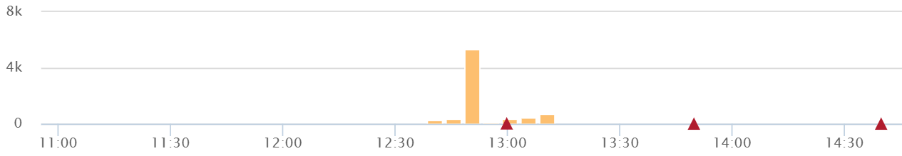

# Reliability

## Summary

Reliability is the ability of a system to perform its required functions correctly under stated conditions for a stated period of time. It is measured with metrics such as mean time between failures, mean time to recovery and error rates, and it is improved by redundancy, fault tolerance and testing.

## Prerequisites

TODO: link the notes a reader should know first.

## Core concepts

### Metrics

#### Customer tickets

The best and worst indicator of application problems is customer support tickets and feedback. The last thing you want is for your users to find bugs or have problems with your software. Because of this, they also make a good indicator of application quality and performance problems.

##### Automated tests pass %

To increase velocity, it is highly recommended that your team makes extensive usage of unit and functional testing. Since DevOps relies heavily on automation, tracking how well your automated tests work is a good DevOps metrics. It is good to know how often code changes are causing your tests to break.

##### Defect escape rate

Do you know how many software defects are being found in production versus QA? If you want to ship code fast, you need to have confidence that you can find software defects before they get to production. Your defect escape rate is a great DevOps metric to track how often those defects make it to production.

##### Service level agreements

Most companies have some service level agreement (SLA) that they operate with. It is also important that you track your compliance with your SLAs. Even if there are no formal SLA, there probably are application requirements or expectations to be achieved.

##### Failed deployments

We all hope this never happens, but how often do your deployments cause an outage or major issues for your users? Reversing a failed deployment is something we never want to do, but it is something you should always plan for. If you have issues with failed deployments, be sure to track this metric over time. This could also be seen as tracking mean time to failure (MTTF).

##### Error rates

Tracking error rates within your application is super important. Not only are they an indicator of quality problems, but also ongoing performance and uptime related issues. Good [exception handling best practices](https://stackify.com/best-practices-exceptions-java/) are critical for good software.

- **Bugs**, Identify new exceptions being thrown in your code after a deployment
- **Production issues**, Capture issues with database connections, query timeouts, and other related issues.

Errors are a fact of life for most applications. It is important that you keep a pulse on your error rates and look for spikes.

##### Mean time to detection (MTTD)

When problems do happen, it is important that you identify them quickly. The last thing you want is to have a major partial or broad system outage and not know about it. Having robust application monitoring and good coverage in place will help you detect issues quickly. Once you detect them, you also have to fix them quickly!

##### Mean time to recovery (MTTR)

This metric helps you track how long it takes to recover from failures. A key metric for the business is keeping failures to a minimum and being able to recover from them quickly. It is typically measured in hours and may refer to business hours, not clock hours.

Having good application monitoring tools in place to quickly identify issues and quickly deploy the fix is important to reducing your MTTR.

## Worked example

TODO: add a concrete, reproducible example with real values.

## Trade offs and when to use it

TODO: describe benefits, costs, alternatives and when this is the wrong choice.

## Common mistakes

TODO: list frequent misunderstandings and failure modes, with the fix for each.

## Practice

TODO: add three to five questions, with answers at the bottom.

## Further reading

- ISO/IEC (2023). [*ISO/IEC 25010:2023 Systems and software Quality Requirements and Evaluation (SQuaRE): Product quality model*](https://www.iso.org/standard/78176.html). ISO. The product quality model whose characteristics include performance efficiency, reliability and maintainability.
- Kleppmann, M. (2017). *Designing Data-Intensive Applications*. O'Reilly Media. A rigorous treatment of replication, partitioning, transactions, consistency models and stream processing.

TODO: check the content of this note against the sources above and record what was verified and when.
