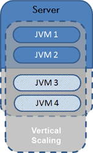
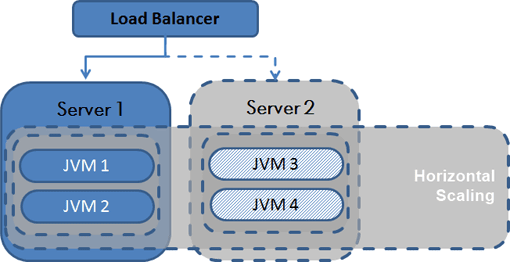

# Scalability

## Summary

A service is said to be scalable if when we increase the resources in a system, it results in increased performance in a manner proportional to resources added. Increasing performance in general means serving more units of work, but it can also be to handle larger units of work, such as when datasets grow.

## Prerequisites

TODO: link the notes a reader should know first.

## Core concepts

### Definition

*A service is said to be scalable if when we increase the resources in a system, it results in increased performance in a manner proportional to resources added*. Increasing performance in general means serving more units of work, but it can also be to handle larger units of work, such as when datasets grow.

In distributed systems there are other reasons for adding resources to a system; for example to improve the reliability of the offered service. Introducing redundancy is an important first line of defense against failures. *An always-on service is said to be scalable if adding resources to facilitate redundancy does not result in a loss of performance*.

Why is scalability so hard? Because scalability cannot be an after-thought. It requires applications and platforms to be designed with scaling in mind, such that adding resources actually results in improving the performance or that if redundancy is introduced the system performance is not adversely affected. Many algorithms that perform reasonably well under low load and small datasets can explode in cost if either requests rates increase, the dataset grows or the number of nodes in the distributed system increases.

A service is **scalable** if it results in increased **performance** in a manner proportional to resources added. Generally, increasing performance means serving more units of work, but it can also be to handle larger units of work, such as when datasets grow.

Another way to look at performance vs scalability:

- If you have a **performance** problem, your system is slow for a single user.
- If you have a **scalability** problem, your system is fast for a single user but slow under heavy load.

The ability to overcome performance limits by adding resources is defined as scalability. No matter how much hardware we have at a certain point we will see decreasing performance. This means increasing response times or a limit in throughput. Will adding additional hardware solve the problem? If yes, then we can scale. If not, we have a scalability problem.

Depending on the changes to the application topology we differentiate the following two scalability approaches:

#### Vertical scaling

Vertical Scaling or scaling up a single node: Adding hardware resources to an existing node. This is often used in virtualized environments where it's possible to expand system resources dynamically. It has the clear advantage that it requires no changes to the application architecture. At the same time the level of scalability will always be hardware constrained.

#### Horizontal scaling

Horizontal Scaling or scaling out by adding nodes: Dispatching requests among additional nodes is the preferred scaling solution when it is easier to add additional nodes than increasing the resources of a single node. This is, especially true in cloud-based environments (see figure below). Eventually we have to scale horizontally anyways as a single machine always has limited capacity. An additional advantage is that inexpensive nodes provide both increased failover capacity and improved application availability. The obvious disadvantage is that clusters must be designed so that nodes can be added and removed with ease.

Comparing these two scaling methods, Vertical Scaling is the simpler of the two and therefore more easily implemented. Horizontal Scaling requires the redistribution and synchronization of data across the new node configuration. Without proper planning, it can be expensive and disruptive to retrofit clusters for scaling out.

### Measurement

#### Load testing

Load testing is a type of performance testing that simulates realistic or expected workloads on a software system and measures its response time, throughput, resource utilization, and error rate. Load testing can help you identify the maximum capacity of your system, as well as the bottlenecks and limitations that affect its scalability. Load testing can also help you evaluate different scaling strategies, such as horizontal scaling (adding more servers or nodes) or vertical scaling (upgrading the hardware or resources of existing servers or nodes).

#### Scalability testing

Scalability testing is a type of load testing that focuses on how the software system behaves under varying levels of load, such as increasing the number of concurrent users, requests, transactions, or data volume. Scalability testing can help you measure the scalability attributes of your system, such as elasticity (how quickly and easily the system can scale up or down), efficiency (how well the system utilizes the available resources), and resilience (how well the system recovers from failures or disruptions). Scalability testing can also help you compare the scalability of different software architectures, designs, or technologies.

### Metrics

#### Performance

These metrics measure the effect of increased workload on the responsiveness, throughput, and resource utilization of the application. Metrics such as response time, requests per second, and CPU or memory usage help developers evaluate the performance of their applications under varying load conditions.

#### Elasticity

These metrics address the system's ability to seamlessly and quickly deploy new instances, respond to changing demands, and release resources when they are no longer required. Metrics such as instance startup time, time to scale out/in, auto-scaling accuracy, and resource utilization ratios can be used to evaluate the elasticity of a system.

#### Resilience

These metrics assess the robustness and fault tolerance of a system, ensuring that it can continue to operate effectively and recover gracefully from failures. Metrics such as mean time between failures (MTBF), mean time to recovery (MTTR), and availability can help developers evaluate their application's resilience under scaled conditions.

## Worked example

TODO: add a concrete, reproducible example with real values.

## Trade offs and when to use it

TODO: describe benefits, costs, alternatives and when this is the wrong choice.

## Common mistakes

TODO: list frequent misunderstandings and failure modes, with the fix for each.

## Practice

TODO: add three to five questions, with answers at the bottom.

## Further reading

- ISO/IEC (2023). [*ISO/IEC 25010:2023 Systems and software Quality Requirements and Evaluation (SQuaRE): Product quality model*](https://www.iso.org/standard/78176.html). ISO. The product quality model whose characteristics include performance efficiency, reliability and maintainability.
- Kleppmann, M. (2017). *Designing Data-Intensive Applications*. O'Reilly Media. A rigorous treatment of replication, partitioning, transactions, consistency models and stream processing.

TODO: check the content of this note against the sources above and record what was verified and when.
