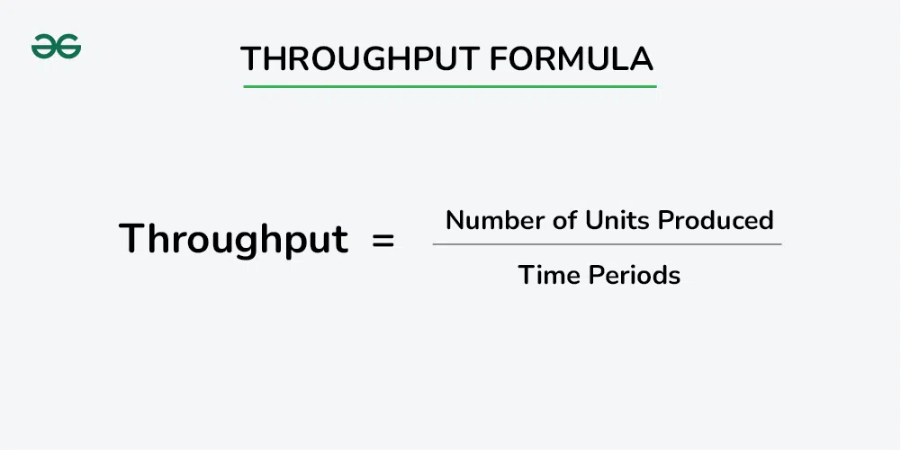
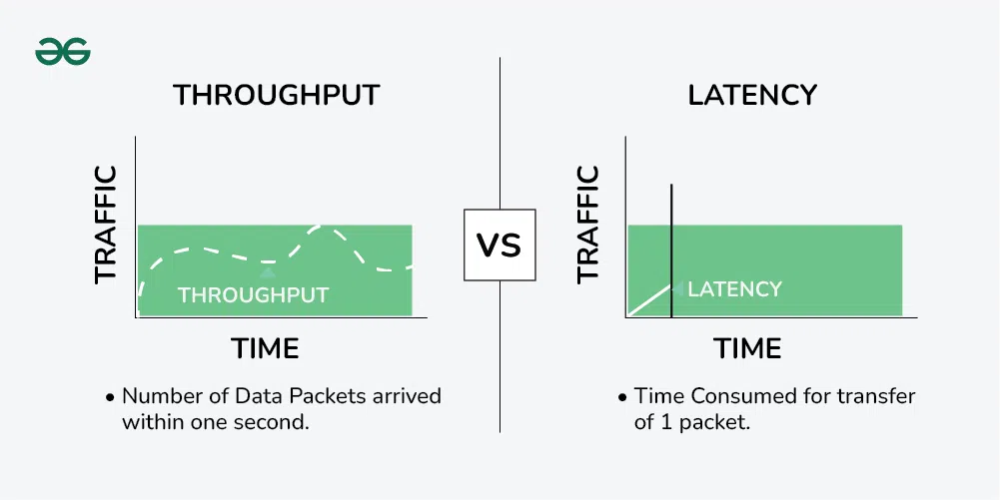

# Throughput

## Summary

Throughput is the amount of work a system completes per unit of time, for example requests per second or transactions per second. It differs from latency, which is the time one request takes. The note covers the factors that limit throughput and the techniques to raise it.

## Prerequisites

TODO: link the notes a reader should know first.

## Core concepts

### Definition

Throughput refers to the number of requests a system can handle at the same time. It is often measured in requests per second, transactions per second, or bits per second.

Throughput refers to the number of requests that a system can handle at the same time or the number of units of data that can be processed in a given period of time. Throughput is often measured in requests per second, transactions per second, or bits per second.

Throughput can be limited by various factors, such as the capacity of the systems involved, the number of available resources, and the efficiency of the algorithms used to process the data. For example, in a network, throughput can be limited by the bandwidth available or the number of connections that can be made at the same time. In a computer, it can be limited by the CPU or memory capacity.

Throughput is an important metric to consider when designing and evaluating systems such as networks, storage systems, and databases. High throughput can lead to more responsive systems and more efficient use of resources, while low throughput can result in slow performance and increased latency.

Here are a few contexts in which throughput is commonly used:

1. **Network Throughput:** In networking, throughput refers to the amount of data that can be transmitted over a network in a given period. It’s an essential metric for evaluating the performance of communication channels.
2. **Disk Throughput:** In storage systems, throughput measures how quickly data can be read from or written to a storage device, usually expressed in terms of bytes per second.
3. **Processing Throughput:** In computing, especially in the context of CPUs or processors, throughput is the number of operations completed in a unit of time. It could refer to the number of instructions executed per second.

#### Latency vs throughput

In most systems, there is a trade-off between latency and throughput, as increasing throughput often requires sacrificing some of the time it takes for the system to respond to each individual request (latency). Therefore, when designing and evaluating systems, it is important to consider both latency and throughput to find the right balance.

### Factors

#### Network congestion

-

    - High levels of traffic on a network can lead to congestion, reducing the available bandwidth and impacting throughput.
    - Solutions may include load balancing, traffic prioritization, and network optimization.

##### Bandwidth limitations

-

    - The maximum capacity of the network or communication channel can constrain throughput.
    - Upgrading to higher bandwidth connections can address this limitation.

##### Hardware performance

-

    - The capabilities of routers, switches, and other networking equipment can influence throughput.
    - Upgrading hardware or optimizing configurations may be necessary to improve performance.

##### Software efficiency

-

    - Inefficient software design or poorly optimized algorithms can contribute to reduced throughput.
    - Code optimization, caching strategies, and parallel processing can enhance software efficiency.

##### Protocol overhead

-

    - Communication protocols introduce overhead, affecting the efficiency of data transmission.
    - Choosing efficient protocols and minimizing unnecessary protocol layers can improve throughput.

##### Latency

-

    - High latency can impact throughput, especially in applications where real-time data processing is crucial.
    - Optimizing routing paths and using low-latency technologies can reduce delays.

##### Data compression and encryption

-

    - While compression can reduce the amount of data transmitted, it may introduce processing overhead.
    - Similarly, encryption algorithms can impact throughput, and balancing security needs with performance is crucial.

### Optimization

#### Network optimization

-

    - Utilize efficient network protocols to minimize overhead.
    - Implement Quality of Service (QoS) policies to prioritize critical traffic.
    - Optimize routing algorithms to reduce latency and packet loss.

##### Load balancing

-

    - Distribute network traffic evenly across multiple servers or paths.
    - Prevents resource overutilization on specific nodes, improving overall throughput.

##### Hardware upgrades

-

    - Upgrade network devices, such as routers, switches, and NICs, to higher-performing models.
    - Ensure that servers and storage devices meet the demands of the workload.

##### Software optimization

-

    - Optimize algorithms and code to reduce processing time.
    - Minimize unnecessary computations and improve code efficiency.

##### Compression techniques

-

    - Use data compression to reduce the amount of data transmitted over the network.
    - Decreases the time required for data transfer, improving throughput.

##### Caching strategies

-

    - Implement caching mechanisms to store and retrieve frequently used data locally.
    - Reduces the need to fetch data from slower external sources, improving response times and throughput.

##### Database optimization

-

    - Optimize database queries and indexes to improve data retrieval times.
    - Use connection pooling to efficiently manage database connections.

##### Concurrency control

-

    - Employ effective concurrency control mechanisms to manage simultaneous access to resources.
    - Avoid bottlenecks caused by contention for shared resources.

## Worked example

TODO: add a concrete, reproducible example with real values.

## Trade offs and when to use it

TODO: describe benefits, costs, alternatives and when this is the wrong choice.

## Common mistakes

TODO: list frequent misunderstandings and failure modes, with the fix for each.

## Practice

TODO: add three to five questions, with answers at the bottom.

## Further reading

- ISO/IEC (2023). [*ISO/IEC 25010:2023 Systems and software Quality Requirements and Evaluation (SQuaRE): Product quality model*](https://www.iso.org/standard/78176.html). ISO. The product quality model whose characteristics include performance efficiency, reliability and maintainability.
- Gregg, B. (2020). *Systems Performance: Enterprise and the Cloud, 2nd Edition*. Addison-Wesley. A methodology for analyzing latency, throughput, utilization and saturation from the hardware up.

TODO: check the content of this note against the sources above and record what was verified and when.
