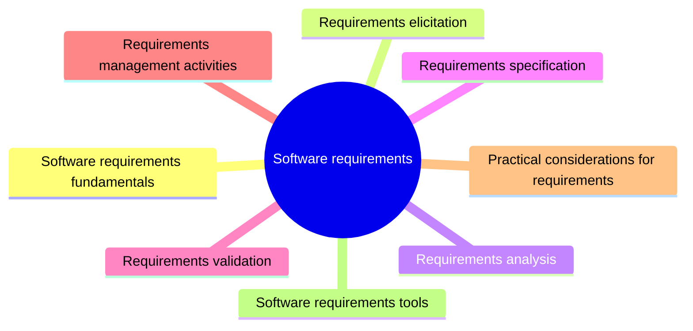

# Software requirements

Software requirements describe what a system must do and the constraints it must respect. This knowledge area covers how requirements are discovered, analyzed, written down, validated and managed while the system changes.

This knowledge area follows Chapter 1 of the [SWEBOK Guide V4.0](https://www.computer.org/education/bodies-of-knowledge/software-engineering) (IEEE Computer Society, 2024). Its sections are the topics of that chapter, in the same order.

## Map

The map shows the sections of this part of the library.

## Topics

- [Software requirements fundamentals](fundamentals/README.md) (planned): The vocabulary of requirements: what a requirement is, the difference between product and project requirements, and between functional and nonfunctional requirements.
- [Requirements elicitation](elicitation/README.md) (planned): How requirements are discovered from stakeholders, documents and existing systems.
- [Requirements analysis](analysis/README.md) (planned): How raw requirements are classified, checked for conflicts and turned into a consistent model.
- [Requirements specification](specification/README.md) (planned): How requirements are written down so that they are unambiguous, testable and traceable.
- [Requirements validation](validation/README.md) (planned): How a team checks that the documented requirements describe the system the stakeholders actually need.
- [Requirements management activities](management-activities/README.md) (1 note): How requirements are changed, traced and kept in step with the design, code and tests over time.
- [Practical considerations for requirements](practical-considerations/README.md) (planned): The iterative nature of requirements work, measuring requirements and the scope of requirements in agile development.
- [Software requirements tools](tools/README.md) (planned): Tools that support modeling, tracing and managing requirements.
