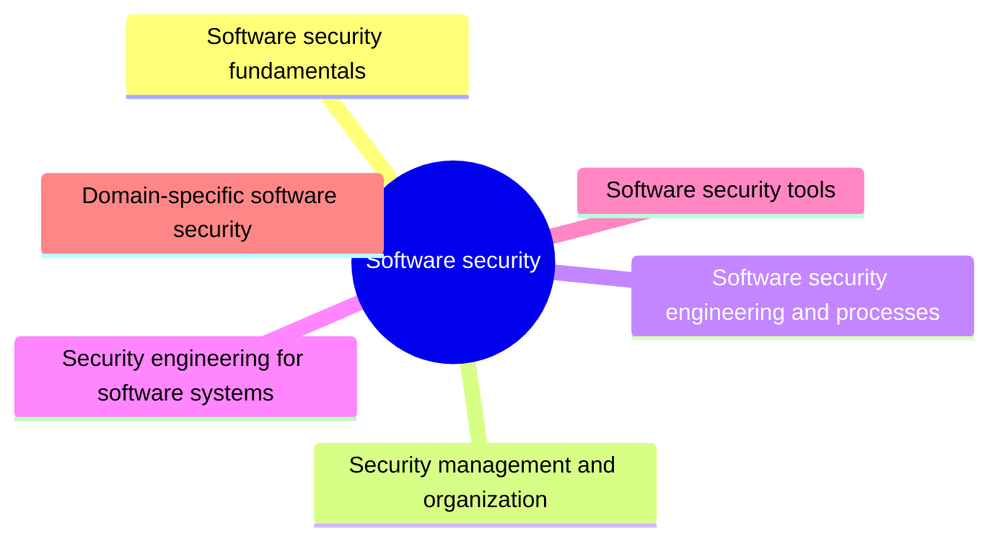

# Software security

Software security is the practice of building software that keeps working correctly under malicious attack. This knowledge area covers security fundamentals, management, secure development processes, security engineering for software systems, tools and domain specific concerns.

This knowledge area follows Chapter 13 of the [SWEBOK Guide V4.0](https://www.computer.org/education/bodies-of-knowledge/software-engineering) (IEEE Computer Society, 2024). Its sections are the topics of that chapter, in the same order.

## Map

The map shows the sections of this part of the library.

## Topics

- [Software security fundamentals](fundamentals/README.md) (planned): Basic concepts: confidentiality, integrity and availability, threats, vulnerabilities and the attack surface of software.
- [Security management and organization](management-and-organization/README.md) (planned): Organizing security work: roles, policies and security in the development organization.
- [Software security engineering and processes](engineering-and-processes/README.md) (1 note): Secure development life cycles, threat modeling and software supply chain practices.
- [Security engineering for software systems](security-engineering-for-software-systems/README.md) (1 note): Applying security in requirements, design, construction and testing of software systems, including the security of APIs.
- [Software security tools](tools/README.md) (planned): Tools for finding vulnerabilities in code, dependencies and running applications.
- [Domain-specific software security](domain-specific/README.md) (planned): Security concerns specific to domains such as cloud, mobile, embedded systems and machine learning.

## Related elsewhere in the library

- [Security patterns](../software-architecture/cloud-design-patterns/security/README.md): Cloud design patterns for identity and controlled access (federated identity, gatekeeper, valet key).
- [Security monitoring](../software-engineering-operations/control/monitoring/security-monitoring.md): Monitoring of security related events in a running system.
