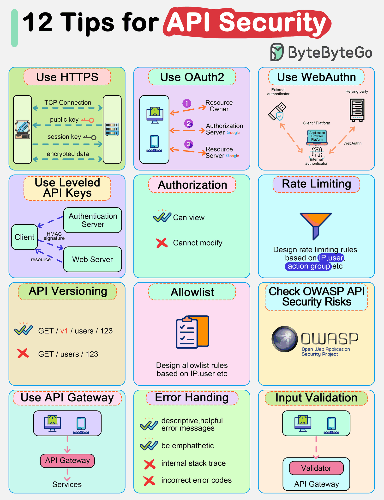

# API security

## Summary

API security protects application programming interfaces from misuse and attack. Because APIs expose application logic and data directly, the main risks are broken authorization, broken authentication, excessive data exposure, missing rate limits and injection. The note summarizes the practices that address them.

## Prerequisites

TODO: link the notes a reader should know first.

## Core concepts

### API security

APIs are the backbone of modern applications. They expose a very large surface area for attacks, increasing the risk of security vulnerabilities. Common threats include SQL injection, cross-site scripting, and distributed denial of service (DDoS) attacks.

## Worked example

TODO: add a concrete, reproducible example with real values.

## Trade offs and when to use it

TODO: describe benefits, costs, alternatives and when this is the wrong choice.

## Common mistakes

TODO: list frequent misunderstandings and failure modes, with the fix for each.

## Practice

TODO: add three to five questions, with answers at the bottom.

## Further reading

- OWASP (2023). [*OWASP API Security Top 10, 2023 edition*](https://api-security.owasp.org/editions/2023/en/0x11-t10/). OWASP. The ranked list of the most critical API security risks with descriptions and prevention guidance.

TODO: check the content of this note against the sources above and record what was verified and when.
