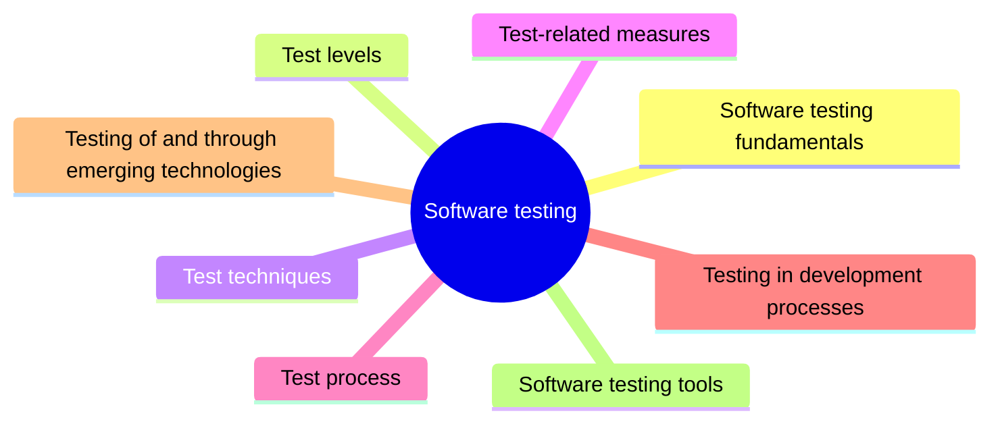

# Software testing

Software testing is the dynamic verification that a program behaves as expected on a finite set of test cases chosen from a usually infinite input domain. This knowledge area covers testing fundamentals, test levels, techniques, measures, the test process and testing in development processes.

This knowledge area follows Chapter 5 of the [SWEBOK Guide V4.0](https://www.computer.org/education/bodies-of-knowledge/software-engineering) (IEEE Computer Society, 2024). Its sections are the topics of that chapter, in the same order.

## Map

The map shows the sections of this part of the library.

## Topics

- [Software testing fundamentals](fundamentals/README.md) (planned): Terminology and key issues of testing: faults and failures, test oracles, the limits of testing and the relation between testing and other verification activities.
- [Test levels](test-levels/README.md) (planned): Targets and objectives of testing: unit, integration, system and acceptance tests, and the purpose each one serves.
- [Test techniques](test-techniques/README.md) (planned): Systematic ways of choosing test cases, based on specifications, code structure, faults, usage or experience.
- [Test-related measures](test-related-measures/README.md) (planned): Measures used to evaluate both the program under test and the tests themselves.
- [Test process](test-process/README.md) (planned): How testing is planned, executed, documented and managed.
- [Testing in development processes](testing-in-development-processes/README.md) (1 note): How testing is embedded in development practices such as test-driven development, behavior-driven development and continuous integration.
- [Testing of and through emerging technologies](emerging-technologies/README.md) (planned): Testing systems built on new technologies such as machine learning, and using such technologies to support testing.
- [Software testing tools](tools/README.md) (planned): Tools that support test design, execution, mocking and reporting.
