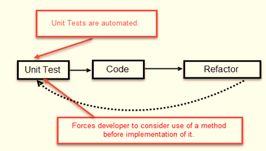
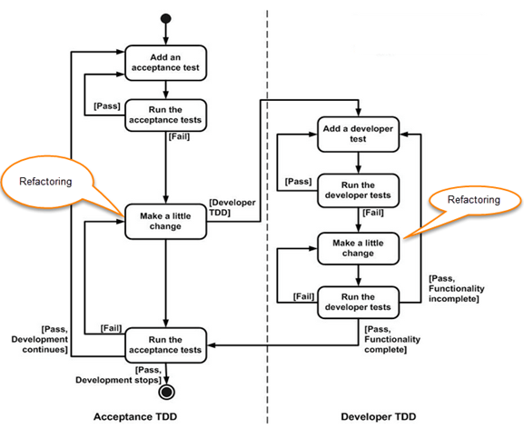

# Test-driven development (TDD)

## Summary

Test Driven Development (TDD) is a software development method where tests are written before code, ensuring quality, simplicity, and maintainability. - TDD involves writing tests before code to ensure functionality. - It emphasizes clear requirements, improving code quality. - Refactoring enhances code readability and maintainability.

## Prerequisites

TODO: link the notes a reader should know first.

## Core concepts

### Definition

Test driven development (TDD) is the process of writing tests for software’s requirements which will fail until the software is developed to meet those requirements. Once those tests pass, then the cycle repeats to refactor code or develop another feature/requirement. In theory, this ensures that software is written to meet requirements in the simplest form, and avoids code defects.

#### Advantages of TDD

Following are the main advantages of Test Driven Development in Software Engineering:

##### Early bug notification.

- Developers test their code but in the database world, this often consists of manual tests or one-off scripts. Using TDD you build up, over time, a suite of automated tests that you and any other developer can rerun at will.

###### Better designed, cleaner and more extensible code

- It helps to understand how the code will be used and how it interacts with other modules.
- It results in better design decision and more maintainable code.
- TDD allows writing smaller code having single responsibility rather than monolithic procedures with multiple responsibilities. This makes the code simpler to understand.
- TDD also forces to write only production code to pass tests based on user requirements.

###### Confidence to refactor

- If you refactor code, there can be possibilities of breaks in the code. So having a set of automated tests you can fix those breaks before release. Proper warning will be given if breaks found when automated tests are used.
- Using TDD, should results in faster, more extensible code with fewer bugs that can be updated with minimal risks.

###### Good for teamwork

- In the absence of any team member, other team members can easily pick up and work on the code. It also aids knowledge sharing, thereby making the team more effective overall.

###### Good for developers

- Though developers have to spend more time in writing TDD test cases, it takes a lot less time for debugging and developing new features. You will write cleaner, less complicated code.

### How it works

**Test Driven Development (TDD)** is software development approach in which test cases are developed to specify and validate what the code will do. In simple terms, test cases for each functionality are created and tested first and if the test fails then the new code is written in order to pass the test and making code simple and bug-free.

Test-Driven Development starts with designing and developing tests for every small functionality of an application. TDD framework instructs developers to write new code only if an automated test has failed. This avoids duplication of code. The TDD full form is Test-driven development.

The simple concept of TDD is to write and correct the failed tests before writing new code (before development). This helps to avoid duplication of code as we write a small amount of code at a time in order to pass tests. (Tests are nothing but requirement conditions that we need to test to fulfill them).

Test-Driven development is a process of developing and running automated test before actual development of the application. Hence, TDD sometimes also called as **Test First Development.**

### Acceptance TDD and developer TDD

There are two levels of TDD

1. **Acceptance TDD (ATDD):** With ATDD you write a single acceptance test. This test fulfills the requirement of the specification or satisfies the behavior of the system. After that write just enough production/functionality code to fulfill that acceptance test. Acceptance test focuses on the overall behavior of the system. ATDD also was known as[**Behavioral Driven Development (BDD)**](https://www.guru99.com/bdd-testing-rest-api-behave.html)**.**
2. **Developer TDD:** With Developer TDD you write single developer test i.e. unit test and then just enough production code to fulfill that test. The unit test focuses on every small functionality of the system. Developer TDD is simply called as **TDD.**The main goal of ATDD and TDD is to specify detailed, executable requirements for your solution on a just in time (JIT) basis. JIT means taking only those requirements in consideration that are needed in the system. So increase efficiency.

## Worked example

TODO: add a concrete, reproducible example with real values.

## Trade offs and when to use it

### TDD vs. traditional testing

Below is the main difference between Test driven development and traditional testing:

TDD approach is primarily a specification technique. It ensures that your source code is thoroughly tested at confirmatory level.

- With traditional testing, a successful test finds one or more defects. It is same as TDD. When a test fails, you have made progress because you know that you need to resolve the problem.
- TDD ensures that your system actually meets requirements defined for it. It helps to build your confidence about your system.
- In TDD more focus is on production code that verifies whether testing will work properly. In traditional testing, more focus is on test case design. Whether the test will show the proper/improper execution of the application in order to fulfill requirements.
- In TDD, you achieve 100% coverage test. Every single line of code is tested, unlike traditional testing.
- The combination of both traditional testing and TDD leads to the importance of testing the system rather than perfection of the system.
- In Agile Modeling (AM), you should “test with a purpose”. You should know why you are testing something and what level its need to be tested.

## Common mistakes

TODO: list frequent misunderstandings and failure modes, with the fix for each.

## Practice

TODO: add three to five questions, with answers at the bottom.

## Further reading

- Beck, K. (2002). *Test-Driven Development: By Example*. Addison-Wesley. The book that describes the red, green, refactor cycle with worked examples.

TODO: check the content of this note against the sources above and record what was verified and when.
